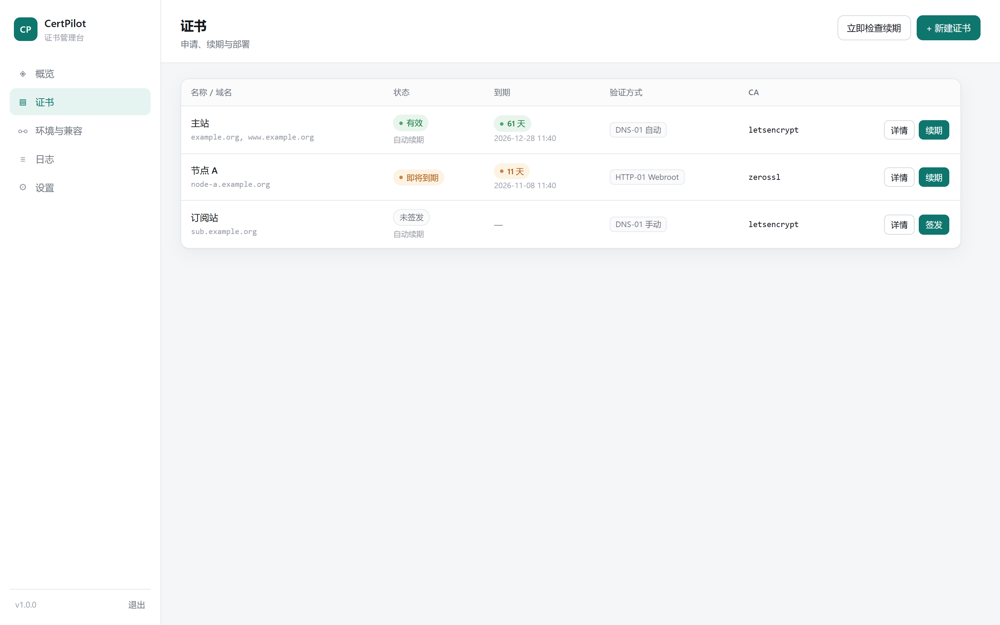

# CertPilot

多域名、多 CA、多验证方式的免费证书申请与自动续期服务。单个 Go 二进制，自带 Web 管理后台，可与 3x-ui 共存而不抢端口。



## 它解决什么问题

3x-ui 的面板只能绑定一组证书（`webCertFile` / `webKeyFile`），菜单里的签发流程一次只处理一个域名；更麻烦的是它用 `acme.sh --standalone --httpport 80` 签发，**不会主动避让端口**，80 被占用时直接失败，而续期失败是静默的——证书到期了才发现。

CertPilot 把证书管理从面板里独立出来：

- 一个界面管理任意多张证书，每张可绑定不同域名、不同 CA、不同验证方式
- 默认走 DNS-01，**完全不占用任何端口**，与 xray/nginx 零冲突
- 需要 HTTP 验证时，优先用 Webroot 复用已有的 80，而不是抢占它
- 签发前做端口预检，冲突时直接给出可执行的替代方案，而不是让你等 CA 报错
- 到期前自动续期，失败退避重试并推送通知

## 核心设计：为什么不会抢端口

证书验证有三种方式，占用的端口完全不同。**选哪种由客户端决定，跟证书商无关**：

| 验证方式 | 需要端口 | 与 3x-ui 共存 | 说明 |
|---|---|---|---|
| `dns-01` | 不占端口 | 完全无冲突 | 通过 DNS API 写 TXT，推荐 |
| `dns-01-manual` | 不占端口 | 完全无冲突 | 界面给出 TXT，人工添加，自动轮询生效 |
| `http-01-webroot` | 复用 80 | 无冲突 | 复用 nginx/caddy 的站点目录 |
| `http-01-standalone` | 独占 80 | 80 空闲时可用 | 签发时临时占用数秒 |
| `tls-alpn-01` | 独占 443 | 与 xray 冲突 | 仅在 443 空闲时使用 |

> 注意：443 不参与 HTTP-01 验证。Let's Encrypt 官方规定 HTTP-01 **只能走 80**，TLS-ALPN-01 **只能走 443**，DNS-01 只查 DNS。所以"443 被 xray 占着"本身不影响签发。

签发前会自动预检：

- standalone / alpn 会先尝试监听目标端口，被占用则直接报错并给出替代方案
- webroot 会检查目录存在、可写
- DNS 会检查必填凭据

## 功能

**证书**
- 多域名 / 通配符 / SAN，单张证书最多 100 个域名
- CA：Let's Encrypt（含 staging）、ZeroSSL、Buypass、Google Trust Services
- 密钥：ECDSA P-256/P-384、RSA 2048/4096
- 签发、续期、吊销、下载（fullchain / privkey / cert / chain）
- 列表里每张证书都有**自动续订开关**：打开则到期前自动续期，关闭则只保留手动续期
- 每行都有**删除**按钮，二次确认后才会执行；只删本程序的记录与存储文件，不动已部署到 `/root/cert/` 的副本
- 证书链、SAN、序列号、剩余天数可视化
- 自动续期窗口可调（默认提前 30 天），失败按 30 分钟 × 次数退避，最多 6 小时

**验证方式**
- DNS 自动：Cloudflare、阿里云、DNSPod、华为云
- DNS 手动：任何 DNS 服务商，界面展示 TXT 记录，自动轮询生效（最长 20 分钟）
- HTTP Webroot：复用现有 Web 服务，零中断
- HTTP 独立监听：临时占用 80
- TLS-ALPN-01：独占 443（会提示与 xray 的冲突）

**证书路径页**
- 每张证书的实际文件路径集中展示，一键复制
- 自动解析 `{domain}` 占位符，直接给出绝对路径（如 `/root/cert/a.com/fullchain.pem`）
- 标注文件是否已生成，并提供 `x-ui cert -webCert ... -webCertKey ...` 命令一键复制
- 未配置部署路径的证书可一键设为 3x-ui 约定路径，并立即写入
- 支持「立即重新部署」，不用等下次续期

**部署**
- 签发成功后原子写入目标路径（先校验证书与私钥配对，不匹配拒绝落盘）
- 支持 `{domain}` 占位符
- 可执行重载命令，例如 `x-ui restart`
- 一键填入 3x-ui 预设：`/root/cert/{domain}/fullchain.pem` + `privkey.pem` + `x-ui restart`

**3x-ui 兼容模式**
- 运行时探测，不做启动期强依赖——3x-ui 可以装在本程序之前，也可以之后
- 每 45 秒自动探测一次，识别后立即生效，无需重启
- 探测项：可执行文件、`/etc/x-ui/x-ui.db`、systemd 单元、服务状态、面板当前证书路径
- 只读方式读取 3x-ui 的数据库，**绝不写入**
- 输出针对当前端口占用情况的具体建议

**一键安装 3x-ui**
- 面板里点一下就把 3x-ui 装好，不用再 SSH 进去跑安装脚本
- 调用官方 `install.sh` 的非交互模式（`XUI_NONINTERACTIVE=1`），不重写上游逻辑，不会随版本漂移
- 面板端口、用户名、密码、路径前缀、SSL 方式都在表单里定，密码默认随机生成
- 安装前体检：root 权限、systemd、端口占用、是否已安装；端口被占用时直接拦下而不是等脚本报错
- 全程日志实时回传，装完自动验收二进制、服务状态与监听端口，并给出可复制的面板地址与账号

**网页终端**
- 浏览器里直接操作服务器，不用另开 SSH 客户端
- 默认**关闭**，需在设置里显式开启；进入时要求重新输入管理密码
- 同一时间只允许一个会话，空闲超时自动断开
- 只记录会话生命周期，**不记录任何输入内容**（否则 sudo 密码、命令行里的密钥都会落进日志）

**其他**
- 单管理员密码（bcrypt）、HttpOnly 会话、CSRF 头校验
- Webhook / Telegram 通知
- 全量操作日志
- 命令行：`serve` / `doctor` / `issue` / `list`

## 安装

### 方式一：一条命令（在线）

```bash
curl -fsSL https://github.com/xbin5678/certpilot/releases/latest/download/install.sh | sudo bash
```

> 注意这里用的是 **Release 里的脚本**，不是源码仓库里那份。源码里的 `install.sh` 带着
> `__REPO_SLUG__` 占位符，由 CI 在打包 Release 时替换成实际仓库地址；直接跑源码版会报
> "仓库地址占位符还没被替换"。如果你确实想跑源码版，加 `--repo 用户名/certpilot` 即可。

带参数安装（端口、管理员密码、ACME 邮箱）：

```bash
curl -fsSL https://github.com/xbin5678/certpilot/releases/latest/download/install.sh \
  | sudo bash -s -- --port 9443 --password 'YourPass123' --email you@example.com
```

### 面板直接上 HTTPS（推荐）

面板跑在公网上就别用明文 HTTP 传管理密码了。装的时候把证书给它：

```bash
# 自动扫描 /root/cert/*/ 下现成的证书对（3x-ui 约定的目录），有几张挂几张
curl -fsSL https://github.com/xbin5678/certpilot/releases/latest/download/install.sh \
  | sudo bash -s -- --tls auto

# 或者自己指定，多个证书用逗号分隔，按 SNI 自动选择
curl -fsSL https://github.com/xbin5678/certpilot/releases/latest/download/install.sh \
  | sudo bash -s -- \
      --tls-cert /root/cert/a.example.com/fullchain.pem,/root/cert/203.0.113.10/fullchain.pem \
      --tls-key  /root/cert/a.example.com/privkey.pem,/root/cert/203.0.113.10/privkey.pem
```

- 脚本会在写 systemd 单元前校验证书与私钥是否配对，配错直接报错，不会把面板起成一个打不开的服务
- 证书续期后按文件 mtime 热加载，**不用重启面板**
- 一旦启用，明文 `http://` 就不再可用；升级时如果没再传 `--tls-*`，脚本会从现有单元里沿用上次的证书路径，不会悄悄退回 HTTP

> 顺序上有个先后问题：证书得先有。所以常见做法是先 `--tls auto` 装一遍（此时 `/root/cert` 里已经有 3x-ui 的证书），
> 或者先用 HTTP 装好、签出第一张证书后再跑一次 `--tls auto` 重装。

### 方式二：离线包

把 `certpilot-offline-amd64.tar.gz` 上传到服务器：

```bash
tar xzf certpilot-offline-amd64.tar.gz
cd bundle
sudo ./install.sh --password 'YourPass123'
```

脚本会优先使用同目录下的 `certpilot` 二进制，不需要联网。

### 低配 VPS：按需启动（默认）

默认安装为 **systemd socket 激活**模式，待机时**没有任何常驻进程**：

| 状态 | 内存占用 | 说明 |
|---|---|---|
| 待机（无人访问） | **0 MB** | 进程已退出，只有 systemd 持有监听端口 |
| 打开网页时 | ~18-22 MB | 首次连接自动拉起，实测 168ms 响应 |
| 空闲 10 分钟后 | 0 MB | 自动退出，下次访问再拉起 |
| 证书续期 | ~20 MB / 4 秒 | systemd 定时器每天跑 4 次，跑完立即退出 |

续期不再依赖常驻进程：`certpilot-renew.timer` 每 6 小时调用一次 `certpilot renew`，检查到期证书、续期、退出。

想改回常驻模式：

```bash
sudo ./install.sh --mode always
```

调整空闲退出时间：

```bash
sudo ./install.sh --idle 30m
```

按需模式下，端口由 `certpilot.socket` 持有，管理入口是 socket 而不是 service：

```bash
systemctl status certpilot.socket      # 看监听状态（即使没有进程也在监听）
systemctl restart certpilot.socket     # 重启（连带重启服务）
systemctl stop certpilot.socket        # 完全停止（连带停进程、释放端口）
systemctl list-timers certpilot-renew.timer
```

服务单元带 `BindsTo=certpilot.socket`，所以停 socket 会同步停进程，不会出现"进程还在、socket 却起不来"的僵局。

> 注意：`systemctl restart certpilot` 在按需模式下没有监听套接字可继承，会直接退出，请操作 `certpilot.socket`。

### 安装脚本做了什么

1. 校验 root 权限与 systemd，识别 `amd64` / `arm64`
2. 优先使用脚本同目录的二进制，否则从 GitHub Release 下载对应架构
3. 安装到 `/usr/local/bin/certpilot`
4. 创建数据目录 `/etc/certpilot`（权限 0750）
5. 生成 systemd 单元、设置开机自启、启动服务
6. 调用 `/api/health` 做健康检查
7. 如果传了 `--password` / `--email`，自动完成管理员初始化

全程无外部依赖：二进制是静态编译的，不需要装 Go、不需要数据库、不需要 Docker。

### 常用命令

| 操作 | 命令 |
|---|---|
| 升级到最新版 | `sudo ./install.sh` |
| 切换按需/常驻 | `sudo ./install.sh --mode ondemand` / `--mode always` |
| 改端口重装 | `sudo ./install.sh --port 8080` |
| 卸载（保留证书与配置） | `sudo ./install.sh --uninstall` |
| 彻底卸载（连数据一起删） | `sudo ./install.sh --purge` |
| 查看状态 | `systemctl status certpilot` |
| 实时日志 | `journalctl -u certpilot -f` |
| 环境体检 | `certpilot doctor` |

`--uninstall` 只删除服务与二进制，`/etc/certpilot` 里的证书和配置会保留；`--purge` 才会连数据一起删除。

### 发布自己的版本

本仓库的 `install.sh` 里写的是占位符 `__REPO_SLUG__`，CI 在打包时会把它替换成实际仓库地址；
如果你想 fork 后自己发版，也可以直接用 `--repo 你的用户名/certpilot` 指定。然后打 tag：

```bash
git tag v1.0.0 && git push --tags
```

GitHub Actions 会自动跑测试、构建 `amd64` 与 `arm64` 两个包，并把 `install.sh`、`uninstall.sh` 一起发布到 Release。

本地构建同样可用：

```bash
make release   # dist/certpilot-linux-{amd64,arm64}.tar.gz
make bundle    # dist/certpilot-offline-amd64.tar.gz（离线包）
```

### 源码运行

```bash
go build -o certpilot .
sudo ./certpilot serve -data ./data -listen :9443
```

## 命令行

```bash
certpilot serve   [-listen :9443] [-data DIR] \
                  [-tls-cert fullchain.pem] [-tls-key privkey.pem]   启动 Web 后台（带 TLS 参数则启用 HTTPS）
certpilot doctor  [-data DIR]                     体检
certpilot list    [-data DIR]                     列出证书
certpilot version

certpilot issue -domain a.com,www.a.com \
  -ca letsencrypt -challenge dns-01 \
  -dns-provider cloudflare \
  -dns-cred CLOUDFLARE_DNS_API_TOKEN=xxx \
  -email you@example.com \
  -deploy-cert /root/cert/{domain}/fullchain.pem \
  -deploy-key  /root/cert/{domain}/privkey.pem \
  -deploy-cmd  "x-ui restart"
```

`issue` 适合放进 CI 或一次性脚本；日常用 Web 界面即可。

## 面板自身启用 HTTPS（支持多张证书）

用本程序签出的证书给自己加 TLS。可以同时挂多张，按 SNI 自动选择，证书续期后自动重载，无需重启：

```bash
certpilot serve -data /etc/certpilot -listen :9443 \
  -tls-cert /root/cert/a.example.com/fullchain.pem,/root/cert/203.0.113.10/fullchain.pem \
  -tls-key  /root/cert/a.example.com/privkey.pem,/root/cert/203.0.113.10/privkey.pem
```

访问 `https://a.example.com:9443` 用域名证书，访问 `https://203.0.113.10:9443` 用 IP 证书，两者都校验通过。

## IP 证书

没有域名也能签发：Let's Encrypt 支持为公网 IP 签发短期证书（约 6 天，自动续期）。

- 程序检测到域名是 IP 时，自动使用 `shortlived` profile，并自动置空 CSR 的 CN（RFC 8738 要求）
- 验证方式只能是 HTTP-01 或 TLS-ALPN-01，DNS-01 对 IP 不可用，程序会在预检阶段直接拦下
- 续期窗口按证书有效期自动收敛（有效期的 1/3 封顶），避免 6 天证书套用 30 天窗口导致无限续期

```bash
certpilot issue -domain 203.0.113.10 -challenge http-01-standalone -email you@example.com
```

## 3x-ui 共存实践

**推荐拓扑**

```
80  → nginx（常驻，只做 ACME webroot 与 301）
443 → xray（所有节点）
9443 → certpilot 面板（HTTPS，证书复用域名那张）
```

- 证书全部走 `dns-01`，或 `http-01-webroot` 指向 nginx 站点根目录
- 部署目标填 `/root/cert/{domain}/`，重载命令填 `x-ui restart`
- 面板证书变化才重启 3x-ui；纯入站证书可以不重启（xray 读取文件路径）

**如果 3x-ui 是后装的**

不用做任何事。CertPilot 每 45 秒探测一次，识别到之后「环境与兼容」页面会出现面板证书路径与针对性建议，部署预设也会自动可用。

**如果 80 被 xray fallback 占着**

不要用 standalone。选 `dns-01` 或 `dns-01-manual`，一行端口都不碰。

## 一键安装 3x-ui

「3x-ui」页面点一下就能装。实现上不重写安装逻辑，而是调用官方脚本的非交互模式：

```bash
XUI_NONINTERACTIVE=1 XUI_USERNAME=... XUI_PANEL_PORT=... XUI_SSL_MODE=none bash install.sh
```

官方脚本已经处理了架构识别、release 校验和、systemd 单元与沙箱硬化、fail2ban、数据库迁移等细节，
自己复刻只会随上游版本漂移。所以这里只做三件事：**装前体检、受控参数、装后验收**。

**安装前会检查**

| 检查项 | 不通过时 |
|---|---|
| root 权限 | 直接报错（写 systemd 单元需要 root） |
| systemd 在运行 | 拒绝安装 |
| 目标端口空闲 | 报错并指出占用进程 |
| 是否已安装 | 提示改用「覆盖安装」，避免误重装 |

**SSL 怎么选**

默认「暂不配置」，装完由 CertPilot 签发证书再部署。这样只有一个 ACME 客户端在管 80 端口，
不会出现 3x-ui 的 acme.sh 和 CertPilot 抢同一个端口、把对方续期搞失败的情况。

如果想让官方脚本自己签，也可以选 IP 或域名模式，但要注意它要求 80 端口空闲。

**装完之后**

面板地址形如 `http://<ip>:<port>/<basePath>`。要换成 HTTPS：

1. 到「证书」页给面板域名（或本机 IP）签发一张证书，部署路径填 `/root/cert/{domain}/`
2. 到「证书路径」页复制两条路径，填进 3x-ui 的面板设置
3. 或者直接执行 `x-ui setting -webCert ... -webCertKey ...`

## 网页终端

在浏览器里直接操作服务器。定位是「不想为了改一行配置去开 SSH 客户端」，不是替代 SSH。

**默认关闭**，这是刻意的：CertPilot 以 root 运行，终端里就是 root shell，
任何拿到面板密码的人都能拿到整台机器。

开启后的防护：

- **默认不再重复要密码**：登录面板后点「终端」直接连上。理由是面板本身已经能通过「部署命令」
  执行任意命令，终端再多问一次密码的边际收益很小，纯粹折腾人。想要更严可以在设置里打开
  「进入终端时要求再输一次密码」。
- 无论哪种模式，都走**一次性票据**（60 秒、用完即废）。票据经 WebSocket 的 URL 参数传递
  （浏览器 WebSocket 无法带自定义头），所以必须一次性且短命 —— 它挡的是别人直接构造
  WebSocket 请求或在别处复用 URL，不是替代登录。
- 同时只允许一个会话，避免两个人抢同一个 shell。
- 空闲超时自动断开（默认 15 分钟，可调）。
- 只记录会话的开始、结束、时长和流量，**不记录输入内容**。记命令听着美好，但 sudo 密码、
  `mysql -p...`、写在命令行里的 token 都会原样进日志，弊大于利。要看历史就在终端里敲 `history`。

**要不要开**

面板只在你自己的内网或跳板机后面，可以开；面板直接暴露在公网且密码是弱口令，先别开。

**实现**

浏览器 ⇄ WebSocket ⇄ 本地 PTY（`creack/pty`）。Linux 上用登录 shell，非 Linux 平台返回「不支持」。
WebSocket 升级需要透传 `http.Hijacker`，日志中间件里的 `statusWriter` 已经补上，
否则升级会失败且只在服务端日志里看到一个含糊的错误。

## 配置

配置存在 `<数据目录>/certpilot.db`（SQLite），包括：

| 项 | 说明 |
|---|---|
| `acmeEmail` | ACME 账号邮箱 |
| `defaultCa` / `defaultKeyType` / `defaultRenewDays` | 新建证书默认值 |
| `compat3xui` | `auto` / `on` / `off` |
| `compatCertDir` | 3x-ui 证书目录前缀，默认 `/root/cert` |
| `webhookUrl` / `telegramToken` / `telegramChatId` | 通知 |
| `eab` | 各 CA 的外部账号绑定凭据（ZeroSSL 可用邮箱自动获取） |
| `terminalEnabled` | 是否启用网页终端，默认 `false` |
| `terminalShell` | 终端使用的 shell，默认 `/bin/bash` |
| `terminalIdleMinutes` | 终端空闲断开时间，默认 15 分钟 |
| `terminalRequirePassword` | 进入终端是否再输一次密码，默认 `false` |

证书文件存放在 `<数据目录>/certs/<证书ID>/`：`fullchain.pem`、`privkey.pem`、`cert.pem`、`chain.pem`、`meta.json`。

## HTTP API

全部接口位于 `/api`，需要会话 Cookie；写操作需带 `X-Requested-With: certpilot`。

```
GET    /api/session              登录状态 / 是否首次使用
POST   /api/setup                首次设置密码
POST   /api/login  /api/logout
GET    /api/overview             概览（含兼容性状态）
GET    /api/certs                列表
POST   /api/certs                创建（issueNow 可直接签发）
GET    /api/certs/{id}           详情
PUT    /api/certs/{id}           修改
DELETE /api/certs/{id}           删除
POST   /api/certs/{id}/issue     签发
POST   /api/certs/{id}/renew     续期
POST   /api/certs/{id}/revoke    吊销
GET    /api/certs/{id}/download?file=fullchain|privkey|cert|chain
GET    /api/certs/{id}/inspect   解析证书内容
GET    /api/jobs  /api/jobs/{id} 任务进度（含待添加的 TXT 记录）
GET    /api/settings  PUT /api/settings
GET    /api/cas  /api/dnsproviders  /api/compat  /api/events
POST   /api/check                立即执行一轮续期检查
GET    /api/xui/state            3x-ui 安装状态与默认参数
POST   /api/xui/install          启动安装任务，返回 taskId
GET    /api/xui/tasks  /api/xui/tasks/{id}
GET    /api/terminal             终端可用性与活跃会话
POST   /api/terminal/ticket      二次验证密码，换取一次性票据
GET    /api/terminal/ws          升级 WebSocket（需 ticket 参数）
```

## 目录结构

```
main.go                  CLI 入口
internal/acme/           ACME 客户端、CA 目录、DNS provider、任务
internal/store/          SQLite 持久层
internal/compat/         3x-ui 探测与端口守卫
internal/deploy/         原子写入与重载
internal/scheduler/      自动续期调度
internal/notify/         Webhook / Telegram
internal/task/           带步骤与日志的通用任务（安装进度）
internal/xui/            3x-ui 一键安装
internal/terminal/       网页终端（PTY + WebSocket）
internal/web/            HTTP 服务与内嵌前端
deploy/                  systemd 单元与安装脚本
```

## 关于数据安全

程序**不会自动删除任何证书记录**。删除只有一条路径：界面上点「删除」并二次确认（对应 `DELETE /api/certs/{id}`）。签发失败只会把状态标为「失败」并保留记录，不会清理。

## 安全说明

- 面板默认监听 `:9443`，默认是明文 HTTP；公网暴露务必用 `--tls auto` 挂上证书，或放在内网/跳板机后面
- 首次访问必须设置密码，密码 bcrypt 存储
- 会话 Cookie 为 HttpOnly + SameSite=Lax；HTTPS 下自动加 Secure
- 所有写接口校验 `X-Requested-With`，配合 SameSite 抵御 CSRF
- DNS API 凭据存在本地 SQLite，请确保数据目录权限为 `0750`
- 建议使用最小权限的 DNS Token（如 Cloudflare 只给 Zone:DNS:Edit）

### 两个高危功能

**一键安装 3x-ui** 会以 root 身份执行从 GitHub 拉取的官方安装脚本。为了降低风险：

- 脚本内容做基本校验（长度 + 关键函数名），防止拿到半截响应或错误页面就执行
- 只从 `raw.githubusercontent.com/MHSanaei/3x-ui/main/install.sh` 固定地址下载，不跟随用户输入的 URL
- 安装脚本运行在独立进程组里，超时会整组杀掉，不留残余子进程

**网页终端**是 root shell，默认关闭。注意：

- 终端里的操作不受 CertPilot 的 CSRF / 审计保护，等价于直接 SSH 登录
- 默认免二次密码，所以**面板密码的强度就是服务器的强度**。如果面板通过公网 IP 直接访问，
  务必用强密码，最好再套一层 nginx 的 IP 白名单或 mTLS
- 想更保守可以打开「进入终端时要求再输一次密码」，或干脆不用时在设置里关掉

## 开发

```bash
go test ./...          # 单元测试
go vet ./...
go build -o certpilot .
```

跨平台构建见 `Makefile`。

## 许可证

MIT
